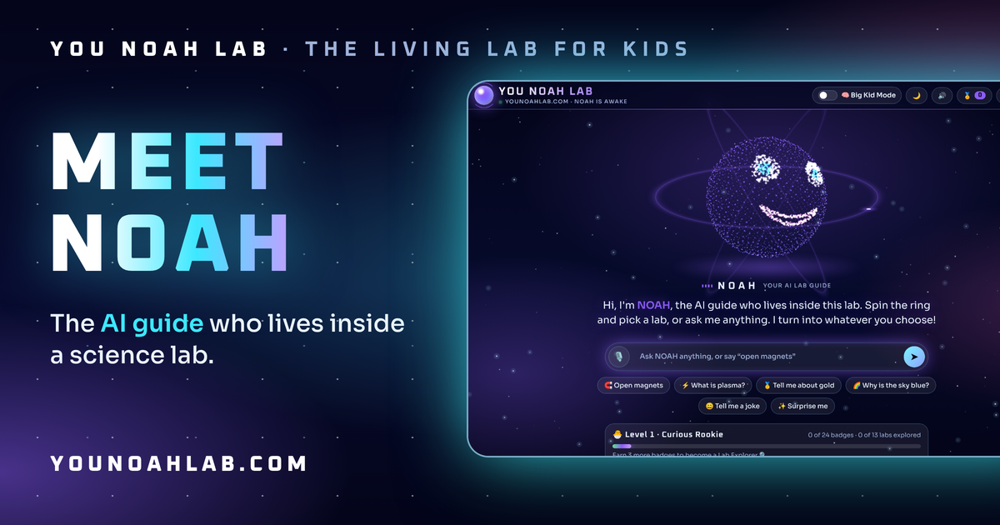

# You Noah Lab

**[younoahlab.com](https://younoahlab.com)** is an interactive 3D science lab for kids, guided by NOAH, an AI guide drawn from about 2,600 points of light.

## What it is

- **21 labs and tools:** elements (with a 3D atom for all 118), sound, circuits, chemistry, light, states of matter, magnets, crystals and metals, DNA (with a 3D double helix), the human body, nature, a "Mad Ideas" physics lab, a lab journal, plus:
  - **Molecule Lab 3D:** 15 molecules and crystals built from measured bond lengths and angles, with tap-to-measure distances and angles.
  - **Space & Gravity:** a 3D solar system driven by real orbital periods, a true-size comparison and a weight-on-other-worlds calculator.
  - **Motion & Forces:** a 3D launcher that integrates Newton's laws, with optional air drag; the no-air result matches the textbook formula.
  - **Science Toolbox:** unit converter, float tester, scale-of-the-universe slider and stopwatch.
  - **Robot Lab 3D:** build a robot and program it with blocks (sequence, loops, sensors) across six levels; Big Kid Mode shows the same program as Python.
  - **AI & Agents Lab:** a scripted agent simulator for tools, memory, fact-checking, step limits and human approval; a prompt workshop; and a real perceptron you can train.
  - **Quantum Lab:** the double-slit experiment sampled from the real intensity formula, a qubit on a 3D Bloch sphere with H, X, Z and S gates, and a two-qubit entanglement circuit.
  - **How It Works:** a 64-page library with five ways to learn each page (read, step map, listen, do, quiz), also published as static pages under `/how/` for search engines.
- **R3D:** a small lit 3D renderer written on raw WebGL for this project (spheres, cylinders, discs, procedural planet surfaces, orbit camera, picking), with a 2D canvas fallback. No libraries.
- **Real science:** results are calculated live from standard equations and published reference values. Where a simulation is simplified, the lab says so.
- **NOAH:** watches the pointer, talks, and reshapes himself into the lab you pick. His built-in answers come only from data that ships with the page, and he says so when he does not know something.

## How it is built

- One self-contained `index.html`: no frameworks, no build step, no external requests.
- NOAH is rendered with raw WebGL and falls back to 2D canvas on devices without 3D.
- No cookies, no browser storage, no trackers. A journal is saved only as a file on the user's device.
- A calm mode, and automatic support for reduced-motion settings.

## Testing

Each release is checked by an automated browser run: all 14 screens on five device sizes, the main user journeys, deep links, and the no-WebGL fallback.

## Privacy

See [privacy.html](privacy.html).

© You Noah Guy. All rights reserved.
